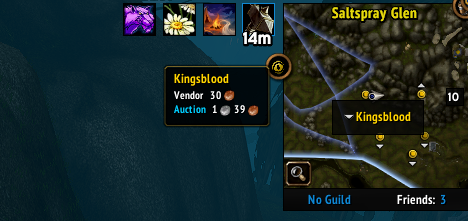

# MinimapGatherTooltip

**Download:** [CurseForge](https://www.curseforge.com/wow/addons/minimapgathertooltip) · [Releases](https://github.com/asboind/MinimapGatherTooltip/releases)

A **WoW Forever** addon (Interface `16001`) that shows vendor sell price and Auctionator auction price when you hover gathering nodes on the minimap.

## What you get in-game

- A compact panel to the left of the minimap (it does not replace the default game tooltip).
- Item name, NPC vendor price, and Auctionator **Auction** line.
- Works only while **Find Herbs** or **Find Minerals** tracking is active, and only for the matching node type.

## Requirements

| Dependency | Purpose |
|------------|---------|
| [Auctionator](https://www.curseforge.com/wow/addons/auctionator) | Auction prices; this addon does not ship Auctionator’s database |
| Gathering tracking | **Find Herbs** or **Find Minerals** enabled on the minimap |

## Installation

1. Extract the zip into `World of Warcraft\_forever_\Interface\AddOns\`.
2. You should have a folder `MinimapGatherTooltip` containing:
   - `MinimapGatherTooltip.toc`
   - `Core.lua`
   - `Database.lua`
   - `Spawns.lua`
3. `/reload` or relog.

## Limitations

- On Forever, the minimap node name is not readable from addon Lua (secret values). Herbs and ore are matched by **cursor position** against a spawn coordinate database.
- Dense zones can occasionally match a nearby node instead of the one under the cursor.
- A live node that is missing from the coordinate source will not show a panel until it is added to the data.

## How it works

1. Cursor over the minimap with a single-line node tooltip (multi-line quest pins are skipped).
2. Nearest gathering point on the current zone map from embedded `Spawns.lua`.
3. Tracking gate: herbs only with Find Herbs, ore only with Find Minerals.
4. Prices from `C_Item` (vendor) and Auctionator’s API.

## Third-party data

- Forever spawn coordinates in `Spawns.lua` are derived from [GatherMate2_Data](https://www.curseforge.com/wow/addons/gathermate2_data) (**forever** set; moonfann / Nevcairiel). See [THIRD_PARTY_NOTICES.md](THIRD_PARTY_NOTICES.md).
- Auctionator is a runtime dependency only; it is not bundled.

## License

Original addon code (Core, Database, TOC, and the Spawns build): **MIT** — [LICENSE](LICENSE).

The coordinate data in `Spawns.lua` is not original content; rights to the upstream database belong to the GatherMate2_Data project (CurseForge lists **All Rights Reserved**). Redistribution of derived coordinates should include attribution; see THIRD_PARTY_NOTICES.

## Version

See `MinimapGatherTooltip/MinimapGatherTooltip.toc` (currently **1.0.0**).